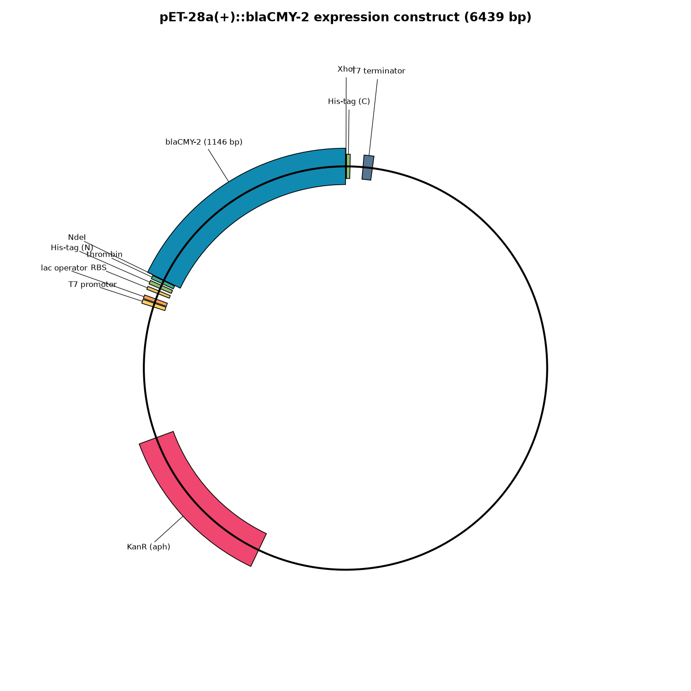
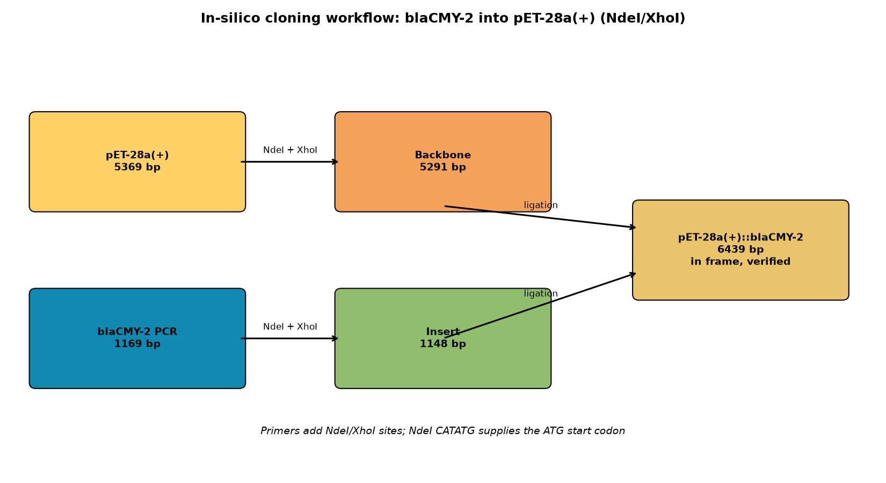
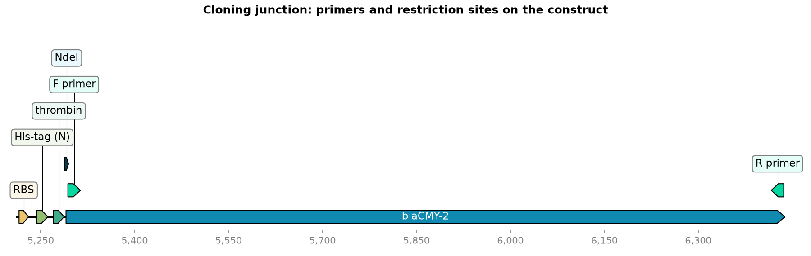

# In-silico cloning of blaCMY-2 into pET-28a(+)

Design and simulation of an expression construct: the **blaCMY-2** beta-lactamase
gene cloned into the **pET-28a(+)** expression vector (NdeI/XhoI). Built with
free open-source tools (pydna, Biopython, dna_features_viewer); the workflow
mirrors a SnapGene in-silico cloning session, step for step, in a form anyone
can re-run.

This continues a small portfolio story: blaCMY-2 was detected in *Salmonella*
Newport SL254 by the companion AMR gene profiling project, and the insert used
here is the exact 1146 bp ORF extracted from that assembly
(GCF_000016045.1, plasmid NC_009140.1, plus strand 72367-73512).

## Results summary

| Metric | Value |
|---|---|
| Insert (blaCMY-2) | 1146 bp, complete ORF (ATG start, TAA stop, 381 aa, no internal stops) |
| Vector (pET-28a(+)) | 5369 bp (NCBI PU845465; identity verified, see Methods) |
| Cloning enzymes | NdeI + XhoI (0 sites in the gene, 1 site each in the vector MCS) |
| Forward primer (NdeI) | 33 nt, 5'-GGAATTCCATATGATGAAAAAATCGTTATGCTG-3', Tm 44.8 C (gene-specific part) |
| Reverse primer (XhoI) | 33 nt, 5'-GGAATTCCTCGAGTTATTGCAGCTTTTCAAGAA-3', Tm 45.8 C (gene-specific part) |
| PCR product | 1169 bp |
| Digested backbone | 5291 bp |
| Digested insert | 1148 bp |
| Final construct | **6439 bp**, circular |
| Reading frame | In frame: the 381 aa ORF translated from the NdeI ATG is identical to native blaCMY-2 |
| Junction sites | NdeI (CATATG) and XhoI (CTCGAG) both regenerated, 1 site each in the construct |

Design note: the NdeI site CATATG embeds the ATG start codon, so the forward
primer continues the gene from its 2nd codon. The expressed protein is exactly
the native 381 aa blaCMY-2 (the NdeI methionine replaces the gene's own start
methionine). The gene keeps its native TAA stop, so the C-terminal His-tag is
not translated; the construct expresses the native untagged protein.

### Plasmid map



### Cloning workflow



### Cloning junction detail



## Methods

1. **Insert preparation.** blaCMY-2 coordinates came from the AMRFinderPlus hit
   on the Newport SL254 assembly (100% identity/coverage to WP_000976514.1).
   The hit (1143 bp) was extended 3 bp to capture the TAA stop codon, giving
   the complete 1146 bp ORF; both plasmid copies are identical, the plus-strand
   copy was used. Verified: ATG start, TAA stop, 381 aa, zero internal stops.
2. **Vector verification.** pET-28a(+) (NCBI PU845465, 5369 bp, annotated
   "pET28a(+) vector") was verified by sequence signatures, not taken on
   trust: the full expression cassette was located by motif search in the
   correct order (T7 promoter, lac operator, RBS, N-terminal His-tag,
   thrombin site, MCS, C-terminal His-tag, T7 terminator), the length matches
   the documented 5369 bp exactly, and NdeI/XhoI cut once each in the MCS.
   The kanamycin resistance gene was identified as a 264-aa ORF in the
   backbone, consistent with aph(3').
3. **Restriction analysis** (Biopython Restriction): NdeI and XhoI cut zero
   times inside blaCMY-2 and once each in the vector, so the pair was kept
   (no fallback needed).
4. **Primer design.** 33 nt primers: 8 nt clamp + 6 nt restriction site +
   20 nt gene-specific. Melting temperatures by Biopython MeltingTemp
   (nearest neighbor, 50 mM Na+).
5. **Assembly simulation** (pydna): PCR with the designed primers (1169 bp),
   digest of vector and product at the empirically determined cut positions
   (NdeI CA^TATG, XhoI C^TCGAG), ligation of the compatible sticky ends.
   Compatible NdeI/XhoI ends ligate deterministically and regenerate both
   sites, so the join is exact.
6. **Verification.** Final construct 6439 bp; insert present once, forward
   orientation; both junction sites regenerated (1 NdeI + 1 XhoI in the
   circular construct); translated ORF identical to native blaCMY-2.
7. **Figures.** Circular plasmid map (matplotlib), workflow diagram
   (matplotlib), linear junction map with primer positions
   (dna_features_viewer).

## Requirements

- Python 3.8+ with `pydna`, `biopython`, `dna_features_viewer`, `matplotlib`
  (all free and open source)
- `pip install pydna biopython dna_features_viewer matplotlib`

## Reproduce

```
# 1. (optional) re-fetch input sequences; bundled copies are used by default
bash data/download_sequences.sh

# 2. Run the full pipeline: analysis, assembly, verification, figures
python3 cloning.py
```

`cloning.py` is fully commented and reads only the bundled files in `data/`,
so step 2 works standalone.

## Repository layout

```
blacmy2-pet28a-cloning/
  data/
    blaCMY2_insert.fasta      # 1146 bp blaCMY-2 ORF (from Newport SL254)
    pET28a_vector.fasta       # 5369 bp pET-28a(+) (NCBI PU845465)
    download_sequences.sh     # re-fetch script with provenance notes
  results/
    primers.csv               # primer sequences, lengths, Tm values
    construct_stats.csv        # all construct metrics
    construct.fasta            # final 6439 bp construct sequence
    restriction_sites.txt      # restriction analysis summary
  figures/
    01_plasmid_map.png        # circular map of the final construct
    02_cloning_workflow.png   # cloning workflow diagram
    03_linear_map_primers.png # junction detail with primer positions
  cloning.py                  # commented pipeline (analysis to figures)
  README.md
```
